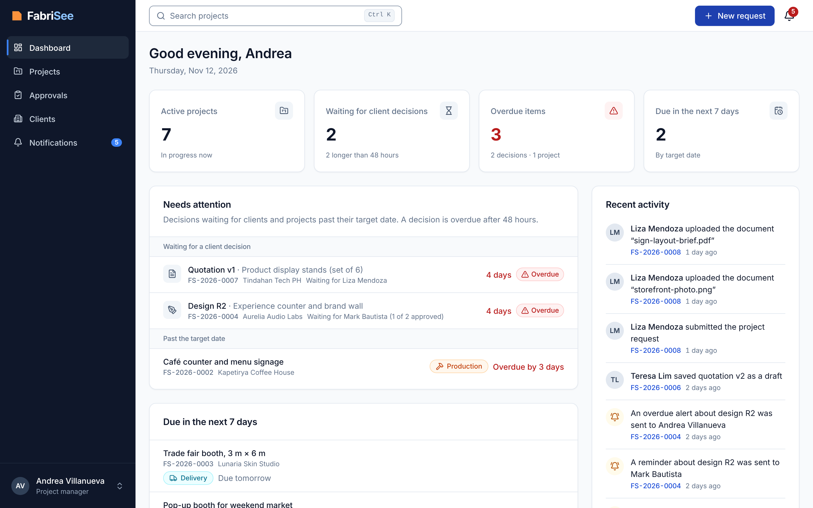
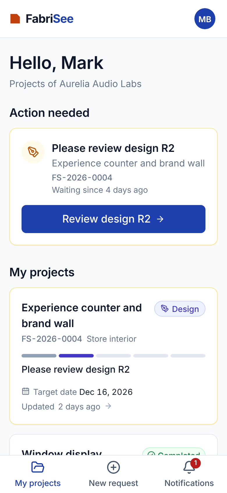

# FabriSee

**FabriSee** is a web-based client management system for the commercial display projects of
**Five Brothers Solutions Inc.**, a custom fabrication company in Parañaque City (store interiors,
product display stands, brand signs, event booths). It is the system of a BS IT thesis at Mapúa
University.

- **Client portal** — clients submit project requests, accept or return quotations, approve or request
  changes to design revisions, and follow the progress of their projects.
- **Staff workspace** — staff keep client and project records, upload quotations and numbered design
  revisions, record project stages, keep project documents, and see a management dashboard.

Every quotation, revision, approval, and stage change is recorded with its date, time, and user.
Projects move through five stages: **Request → Design → Production → Delivery and Installation →
Turnover**.

> **Status:** Milestones 0 to 2 are done (foundation, data model, sign-in, and read-only screens on
> demo data). Requests, quotations, approvals, progress updates, and reminders arrive in Milestones 3
> to 8. See [`PROGRESS.md`](PROGRESS.md) for what is done and what is next, and
> [`FABRISEE_BUILD_GUIDE.md`](FABRISEE_BUILD_GUIDE.md) for the full specification.

<p>
  
  
</p>

More screens, at desktop and phone size: [`docs/screenshots/`](docs/screenshots/).

## Try it in GitHub Codespaces (nothing to install)

1. On the repository page choose **Code → Codespaces → Create codespace on main**.
2. Wait for the setup to finish (a few minutes the first time). The codespace installs everything,
   creates the database, loads the demo data, and starts the app.
3. The **FabriSee** tab opens by itself. If it does not, open the **Ports** tab and click the address
   of port **5173**.
4. Sign in with one of the demo accounts below.
5. **Stop the codespace when you are done** (Codespaces menu → Stop current codespace). Personal
   accounts have a monthly free quota.

After merging a new pull request, create a fresh codespace, or run this in the terminal of an
existing one:

```bash
git pull && make setup && make reset-demo
```

If the app is not running (for example after you closed its terminal), run `make dev`.

## Demo accounts

All demo accounts use the password **`FabriSee@2026`**.

| Email | Name | Role | Lands on |
|---|---|---|---|
| `owner@fabrisee.test` | Teresa Lim | Administrator (owner) | Staff workspace |
| `pm@fabrisee.test` | Andrea Villanueva | Project manager | Staff workspace |
| `designer@fabrisee.test` | Paolo Garcia | Designer | Staff workspace |
| `production@fabrisee.test` | Ramon Dizon | Production staff | Staff workspace |
| `joanna@aurelia.test` | Joanna Cruz | Client, Aurelia Audio Labs (designated approver) | Client portal |
| `mark@aurelia.test` | Mark Bautista | Client, Aurelia Audio Labs (designated approver) | Client portal |
| `liza@tindahantech.test` | Liza Mendoza | Client, Tindahan Tech PH (designated approver) | Client portal |
| `nico@kapetirya.test` | Nico Ramos | Client, Kapetirya Coffee House (designated approver) | Client portal |
| `bianca@lunaria.test` | Bianca Flores | Client, Lunaria Skin Studio (designated approver) | Client portal |
| `ella@lunaria.test` | Ella Navarro | Client, Lunaria Skin Studio (views only) | Client portal |

The sign-in page lists these accounts under **Demo accounts** while the demo data is enabled.

> **Warning.** The demo data, the demo password, and the demo account list exist only for
> development and demonstrations. All companies, people, and files in it are fictitious. A production
> deployment must set `ALLOW_DEMO_SEED=0` and must never run `seed_demo` or `reset_demo`.

The demo data has eight projects, one for each situation the system must show: a design revision
waiting for one of two approvers for three days, a quotation sent three days ago with no decision, an
approved and locked design in production, a project in delivery and installation, a completed
project with turnover documents, a new request, a revision with changes requested, and a returned
quotation with a new draft. Dates are relative to the day the data is loaded.

## Commands

Run these from the repository root.

| Command | What it does |
|---|---|
| `make setup` | Install backend and frontend dependencies, create `.env`, migrate, load the demo data |
| `make dev` | Run Django (port 8000), Vite (port 5173), and the reminder scheduler together |
| `make test` | ruff, pytest, ESLint, Prettier, TypeScript check, Vitest |
| `make e2e` | Playwright end-to-end tests: sign-in for each role, who may see what, the main screens |
| `make screenshots` | Capture the key screens into `docs/screenshots/` at 1440 × 900 and 390 × 844 |
| `make seed` | Load the demo data (does nothing if it is already loaded) |
| `make reset-demo` | Delete all data and uploads, then load fresh demo data |
| `make format` | Format the code (ruff, Prettier) |
| `make help` | List every command |

Open the app at <http://localhost:5173> (in Codespaces, the forwarded port 5173).

`make e2e` and `make screenshots` need a browser for Playwright. Install it once with
`cd frontend && npx playwright install chromium`. They start the app themselves, or use the one
that `make dev` is already running, and they expect the demo data (`make reset-demo` for a fresh
copy). Every pull request also runs `make test` and the end-to-end tests on GitHub Actions.

Other addresses in development:

- Django admin: <http://localhost:5173/admin/> (sign in as `owner@fabrisee.test`)
- API documentation: <http://localhost:8000/api/docs/>
- API health check: <http://localhost:5173/api/health/>

## Local machine (optional)

Install Python 3.12 and Node.js 22.22 or newer, then:

```bash
make setup
make dev
```

## How it is built

| Layer | Choice |
|---|---|
| Backend | Python 3.12, Django 5.2 LTS, Django REST Framework; business rules in `services.py` |
| Database | SQLite through the Django ORM (`backend/data/`, not committed); PostgreSQL by setting `DATABASE_URL` |
| Frontend | React, TypeScript, Vite, Tailwind CSS, shadcn/ui (Radix), TanStack Query, React Router |
| Sign-in | Django session authentication with CSRF on one origin (no JWT) |
| Files | Local disk under `backend/media/` (not committed), served only through permission-checked API views |
| Email | Stored in a database email log in development; SMTP in production |
| Reminders | `manage.py run_scheduler` (part of `make dev`); `manage.py send_due_reminders` for cron |

```
backend/
  config/            Django project (settings for dev, test, prod)
  apps/
    accounts/        users, roles, sign-in API, permissions, privacy notice
    clients/         client companies
    projects/        projects, designated approvers, stage updates, documents, dashboard
    quotations/      quotation versions
    designs/         design revisions and approvals
    notifications/   in-app notifications, email log, reminders, scheduler
    activity/        activity log
    core/            system settings, API error format, demo data
frontend/
  src/
    components/ui/   shadcn/ui primitives
    components/      shared FabriSee components (StageChip, StageTracker, ...)
    layouts/         staff workspace, client portal, sign-in
    features/        screens by feature
    lib/             API client, sign-in state, formatting, constants
  e2e/               Playwright specs
docs/
  decisions/         short decision records
  screenshots/       desktop and phone captures of the key screens
```

## Working on FabriSee

The group does not need a local setup. Each Claude Code session works on its own branch and opens a
pull request; review it on GitHub, merge it, and try it in a codespace. The session prompts are in
section 18 of the build guide. `CLAUDE.md` holds the standing instructions for Claude Code.

`.claude/settings.json` pre-approves the commands Claude Code needs for this project (file edits,
`make`, `git`, `npm`, Python tools, and the GitHub pull request tools), so a session can finish a
milestone without stopping for permission prompts. Merging a pull request is never pre-approved: the
group reviews and merges. For fully unattended runs, also choose **Auto** in the mode menu next to the
prompt box when starting a session.

## Scope

In scope: client and project records, project requests, quotation management (versions and
decisions), design revision tracking and approval, progress tracking, the project document
repository, notifications and reminders, the management dashboard, role-based access, and an activity
log. Out of scope: 3D or AR viewers, machine integration, online payments, SMS, native mobile apps,
AI chatbots, cost computation, inventory, payroll, and accounting.
